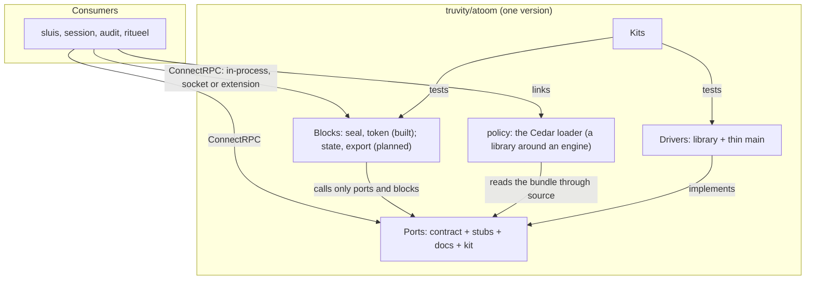

# Architecture

How the repository is laid out, what each kind of directory is, and the rules that keep the libraries apart. The decisions behind it are the [records](decisions/README.md).

## The kinds of thing

| Kind | What it is | Records |
| --- | --- | --- |
| **Port** | a Protobuf contract, its generated ConnectRPC stubs (Go, Rust), its documentation and a conformance kit | [0002](decisions/0002-ports-and-drivers-over-connectrpc.md) |
| **Driver** | one implementation of one port: a library plus a thin main that serves it on a socket | [0002](decisions/0002-ports-and-drivers-over-connectrpc.md), [0010](decisions/0010-distribution-per-driver-and-lambda.md) |
| **Block** | a contract built from other ports and blocks, with no backend code, a kit, and rules supplied by its host | [0008](decisions/0008-blocks.md) |
| **Kit** | the tests of a port or a block, run through its ConnectRPC endpoint in any language | [0002](decisions/0002-ports-and-drivers-over-connectrpc.md), [0014](decisions/0014-what-atoom-proves.md) |
| **Library around an engine** | code a consumer links directly around a library of its language, reading through ports, with a test set that holds the Go and Rust twins to one behaviour: [`policy`](../policy/README.md), the Cedar loader | [0011](decisions/0011-cedar-as-a-library.md), [0019](decisions/0019-the-policy-bundle-and-its-loader.md) |



A consumer calls a port or a block through its generated client, always, also in one process ([0009](decisions/0009-connectrpc-in-process.md)). The one exception is Cedar, which is used as a library ([0011](decisions/0011-cedar-as-a-library.md)); atoom's [`policy`](../policy/README.md) loads the signed bundle for it, in Go and in Rust ([0019](decisions/0019-the-policy-bundle-and-its-loader.md)).

## Repository layout

```text
atoom/
  versions.yaml          the pinned runtimes (record 0015)
  go.work                development only; lists every Go module
  Cargo.toml             one workspace; explicit member list, no globs
  Justfile               the recipes that CI and people run
  common/                Refusal and IndexEntry, the call context (Go)
  socket/                the socket host: dial, serve, the caller guard, the call context (Rust crate and Go module)
  key/                   port: proto, stubs, README, docs/
    conformance/         the key kit (a Go module of its own)
    software/  yubikeypiv/  awskms/     drivers
    slotplan/  pinrelease/  usbccid/   small libraries of the card drivers
  store/                 port: items
    conformance/  rqlite/  memory/  dynamodb/
  source/  blob/  transport/  index/  destination/    the other ports, same shape
  policy/                the Cedar loader: Go module and Rust crate side by side, and the decision test set in testdata/ (record 0019)
  blocks/                blocks, one directory each
    seal/                the seal block: proto, stubs, the Go implementation, README, docs/, the kit (package conformance)
    token/               the token block: the same, with Rust stubs (a crate beside the Go module) and a thin main, cmd/token
  deploy/release/        the Dockerfile templates of the images
  tools/                 release scripts, isolation check, conformance scripts
  docs/                  this page, the call context, the socket guard, packages, release, provenance, plan, decisions, archive
```

- A directory with a `go.mod` is a Go library, one with a `Cargo.toml` a Rust library. Both files may sit side by side in one directory (Go sources at the root, Rust in `src/`), which is how a port holds stubs in two languages.
- Each library has its own `README.md` and a `docs/` folder.
- Cargo members and `go.work` `use` lines are listed explicitly, so that a Go-only directory needs no exclusion.
- The module path is `github.com/truvity/atoom/<dir>`, the crate `atoom-<dir with dashes>`, the proto package `atoom.<port>.v1alpha1`.
- A block lives in `blocks/<name>/`: its contract, stubs, README, `docs/`, kit and implementation, one library in the language of its main host ([0008](decisions/0008-blocks.md)). The first block, [`seal`](../blocks/seal/README.md), sets the pattern that the others follow:

  | Part | Where (for a block `<name>`) |
  | --- | --- |
  | the contract | `blocks/<name>/proto/atoom/<name>/v1alpha1/*.proto`, a module of `buf.yaml`, package `atoom.<name>.v1alpha1` |
  | the stubs | `blocks/<name>/gen/`, made by `blocks/<name>/buf.gen.yaml` (`just gen`); Rust stubs only when a Rust consumer calls the block: the crate `atoom-blocks-<name>` in the same directory, made by its `build.rs` (`blocks/token`) |
  | the implementation | the library at the root of the directory: Go module `github.com/truvity/atoom/blocks/<name>`, or the crate `atoom-blocks-<name>`; `New(ctx, Options)` takes the clients of its dependencies, and `Handler()` (Go) or `router()` (Rust) is the ConnectRPC handler |
  | the host's hooks | in its options: the declaration of its purposes or kinds, the rules (a hook asked before every call), and where its facts go |
  | the kit | the package or module `conformance` of the block, speaking the contract only, with its own declaration and rules, and the command `<name>-conformance` under `conformance/cmd/` |
  | the kit's run | `tools/scripts/conformance-<name>.sh`, a recipe `conformance-<name>` of `just conformance`: the kit over the memory drivers of the block's dependencies, each behind the socket of its thin main |
  | the thin main | `blocks/<name>/cmd/<name>`, when a host in another language reaches the block over a socket: a row `block-<name>` of the release table, released in the forms of a driver as `atoom-block-<name>` ([packages](packages.md)); `blocks/token` has one |
  | the page | `blocks/<name>/docs/<name>-block.md`: what it is built from, the calls, the contract, the hooks, the refusals, the kit and how to host it |

## Dependency rules

Checked in CI by `just check-isolation` ([0003](decisions/0003-libraries-with-thin-dependencies.md)):

- a **port** module requires only the ConnectRPC and Protobuf runtimes and what their generated code needs, besides the `common` types;
- a **driver** may require the `common` types, its own port, the kit of its own port (for tests), a shared library and its own backend SDK. It may not require another driver or the code of another port;
- **no driver requires another driver.** A small library that several drivers of one port need is a shared library, listed in `tools/isolation/shared.txt` (`socket`, `key/slotplan`, `key/pinrelease`, `key/usbccid`, `blob/fsdir`);
- a **block** requires only `common`, ports, shared libraries and other blocks, with no cycle, and never a driver or a backend ([0008](decisions/0008-blocks.md)); no port and no driver requires a block. A block may require the libraries it needs besides (`blocks/seal`: AES key wrap from `go-jose`);
- a **library around an engine** (`policy`, [0019](decisions/0019-the-policy-bundle-and-its-loader.md)) requires only `common`, ports, shared libraries and its engine, never a driver or a block, and no library of the repository requires it;
- a consumer that takes `key` and `key/software` has no AWS SDK, PC/SC, DynamoDB or PostgreSQL code in its module graph.

The cgo and PC/SC dependency of `key/yubikeypiv` is behind the build tag `atoom_card`. Without the tag the driver builds with no C code and refuses to open a card.

## Ports

Every port has one page, `<port>/docs/<port>-port.md`, in the same shape: the calls, the contract, **Capabilities**, the refusals, the drivers (built and planned), the call context (a link), and how to write a driver. The call context is stated once, in the [call context](call-context.md), and every port page links to it.

| Port | Page | What it abstracts | Drivers built |
| --- | --- | --- | --- |
| `key` | [key port](../key/docs/key-port.md) | private keys: sign, agree, attest | `software`, `yubikeypiv`, `awskms` |
| `store` | [store port](../store/docs/store-port.md) | items with versions, expiry, indexes and a change log | `rqlite`, `memory`, `dynamodb` |
| `source` | [source port](../source/docs/source-port.md) | named values and their bytes, watched or not | `file`, `credential`, `appconfig` |
| `blob` | [blob port](../blob/docs/blob-port.md) | write-once objects and a few conditional pointers | `fs`, `fsreadonly`, `s3` |
| `transport` | [transport port](../transport/docs/transport-port.md) | a durable ordered queue to one consumer | `spool`, `nats`, `sqs` |
| `index` | [index port](../index/docs/index-port.md) | a search index of the records of an append-only log | `sqlite` |
| `destination` | [destination port](../destination/docs/destination-port.md) | where a published document goes | `dir` |

`common` is not a port: it holds the types every port speaks ([refusal](../common/docs/refusal.md)).

- **Capabilities.** A port with optional calls or properties has a `Capabilities` call: `key` (the store, its algorithms, the purposes its host declared, attestation), `store` (the engine, the change log, the durability of [record 0012](decisions/0012-store-durability.md)) and `source` (how a newer version is reported). A driver answers `unimplemented` for a call it does not offer, and the kit skips the cases that need it. The other ports have none today, and their pages say so.
- **Generic ports.** The blob, transport and index contracts were written for an audit log; since step B12 ([record 0025](decisions/0025-generic-blob-transport-and-index.md)) they name no product: the host declares its blob pointers, a transport message is an id and an opaque payload, and the host declares an index's kinds and columns. `just check-vocabulary` keeps audit's names out of their contracts. The audit model lives in [truvity/audit](https://github.com/truvity/audit).
- **Refusals.** A refusal is a Connect error with the `Refusal` detail of `common`: a reason from a closed list and the path of the field at fault, never a value.

## Drivers

Each driver has a README and a page in its `docs/` folder. [Packages](packages.md) lists every driver with the forms it is released in, Lambda included. Every thin main guards its socket the same way ([socket guard](socket-guard.md)). The research behind a backend is next to the driver ([0006](decisions/0006-driver-research-lives-here.md)).

## Where each kind of fact lives

| Fact | Home |
| --- | --- |
| a decision, and why | [decision records](decisions/README.md) |
| the rules of a contract | the port's page |
| how a driver behaves | the driver's README and `docs/` |
| what a backend can do, measured | the driver's `docs/research/` |
| the deadline and the correlation id | [call context](call-context.md) |
| the socket guard | [socket guard](socket-guard.md) |
| names, forms, Lambda, images | [packages](packages.md) |
| how a release is made | [releasing](release.md) |
| where code was copied from | [provenance](provenance.md) |
| what is built and what comes next | [plan](plan.md) |
| history of the extraction | [archive](archive/README.md) |
