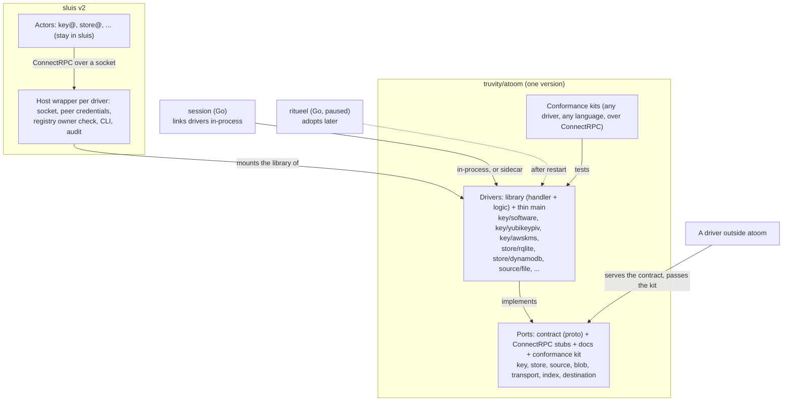
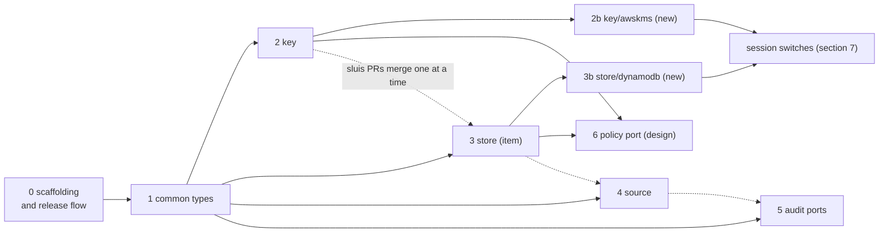

# atoom: the extraction plan

Status: plan, 2026-11-18. Docs only: no code has moved yet. This page says what moves out of sluis `main` into this repository, in which order, and how each step keeps the CI of both repositories green. Read-only research was done on truvity/sluis `main` (commit `f67cf9f`), truvity/session `master` (`9359805`) and truvity/ritueel `main` (`a569f93`). Nothing in those repositories was changed.

Claims about the code are READ (from the files at those commits) unless marked UNVERIFIED.

## 1. The design principle: ports and drivers over ConnectRPC

atoom is, by design, **abstract interfaces (ports) with implementations (drivers)**, and it is **extensible**: anyone can write a new driver, inside or outside this repository, and prove it with the port's conformance kit ([record 0002](decisions/0002-ports-and-drivers-over-connectrpc.md)).

- **A port** is four things and no code of any backend:
  1. its Protobuf contract (today `proto/sluis/port/*` in sluis);
  2. the generated ConnectRPC stubs for each language that needs them (Go, Rust);
  3. its documentation (the contract's rules, in prose);
  4. a **conformance kit** that tests any driver through its ConnectRPC endpoint, whatever the driver's language. A port has no dependency beyond the ConnectRPC and Protobuf runtimes.
- **A driver** is one implementation of one port, with its own thin dependencies and its own documentation. It is two parts, both in atoom:
  - a **library**: the ConnectRPC handler and the logic behind it, which a consumer in the same language embeds in-process (in Go by mounting the Connect handler on an in-memory transport);
  - a **thin main** that serves the library on a socket, as its own process.

  The contract is the same either way. In-process matters on the Lambda shape, where there are no sidecars: a driver that a Lambda function needs must link into the function.
- **How a driver outside atoom plugs in.** It serves the port's contract (Go: implements the generated handler interface; Rust: implements the generated service trait) and passes the port's conformance kit against its endpoint. It needs nothing from atoom except the contract and the kit. A consumer may offer config-driven selection by name; atoom ships an optional small registry helper per language (a map from driver name to a constructor) and nothing depends on it.
- **The language is a choice per driver, not per repository.** A Go consumer can run a Rust driver as a sidecar over ConnectRPC, or link a Go one in-process. atoom does not unify languages.
- **Naming.** A port is a directory named for what it abstracts (`key/`, `store/`). Each driver is a subdirectory named for the backend in lower case without separators (`key/software`, `key/yubikeypiv`, `key/awskms`). Go module path `github.com/truvity/atoom/<dir>`; Rust crate `atoom-<dir with dashes>`; proto package `atoom.<port>.v1alpha1`.



### Pinned runtimes (ConnectRPC and Protobuf), and how atoom keeps them in step with sluis

READ from sluis `main`:

| What | Pin in sluis |
| --- | --- |
| Rust `connectrpc` | `=0.9.1` (features `json`, `gzip`, `client`, `server`) |
| Rust `buffa`, `buffa-types` | `=0.9.2` (feature `json`) |
| Rust `connectrpc-build` | `=0.9.0` |
| Go `connectrpc.com/connect` | `v1.21.1` (`protoc-gen-connect-go` runs as a `go tool` of the same version) |
| Go `google.golang.org/protobuf` | `v1.36.12` (`protoc-gen-go` 1.36.12) |
| `buf` | 1.75.0 |
| Rust toolchain | 1.99.1 (edition 2024) |
| Go | 1.27.0, toolchain 1.27.4 |

How they stay in step:

- atoom holds the pins in one file, `versions.yaml`, and every library uses them. sluis and session pin the same values.
- The order of a bump is always atoom first (released), then the consumers in their next change, never the reverse. Rust pins are exact (`=`) and two versions of `connectrpc` in one build fail to compile (the types differ), so a mismatch cannot pass unnoticed; for Go, a CI job in each consumer (`just atoom-check`) compares its `go.mod` with the `versions.yaml` of the atoom version it uses.
- One Renovate group per runtime in all three repositories, so the three bump PRs open together.
- Sluis's own `kits/*` (the UNIX-socket host, peer credentials, call-graph guard) pin the same Rust runtime; it is the same pin, not a second one.

## 2. What the maintainer has decided

| Decision | Record |
| --- | --- |
| Purpose and name; session targets atoom, not sluis | [0001](decisions/0001-purpose-and-name.md) |
| Ports and drivers, extensible, over ConnectRPC; a driver is a library plus a thin main | [0002](decisions/0002-ports-and-drivers-over-connectrpc.md) |
| Libraries with their own thin dependencies and documentation; Go module per library, Rust crate per library | [0003](decisions/0003-libraries-with-thin-dependencies.md) |
| linux/amd64 and linux/arm64 for every library, darwin where it makes sense | [0004](decisions/0004-multi-architecture.md) |
| One version for the whole repository; per-module Go tags, shared Rust version | [0005](decisions/0005-one-version-for-the-repository.md) |
| Research about drivers moves here, next to the driver | [0006](decisions/0006-driver-research-lives-here.md) |
| atoom releases the driver binaries, packages and images under the one version, mirroring sluis's release practice; no Helm charts | [0007](decisions/0007-release-management.md) |
| Code moves as it is, in both languages; no rewrite during the move | this plan, set to go fast |
| AT1 A: all seven ports move; no Helm charts in atoom; the other calls of section 10 | coordinator's calls 2026-11-18, for the maintainer's review |

## 3. What is in sluis today

READ from `main`. The ports are already ConnectRPC services over UNIX sockets, and each driver is its own executable (sluis ADR 0012, "The unit of choice is the executable"; ADR 0013).

| Port (sluis proto) | Contract | Drivers in sluis | Language | Kit |
| --- | --- | --- | --- | --- |
| `sluis.port.keystore` (+ `unlock`) | `proto/sluis/port/keystore/v2alpha1/{keystore,unlock}.proto`: Capabilities, Ensure, Sign, PublicKey, Ecdh, Attest, VerifyAttestation, BeginPinRelease, SealPin, FinishPinRelease; Status, Unlock | `drivers/key/software`, `drivers/key/yubikey-piv` | Go | the suite is copied inside each driver (`internal/driver/suite.go`, same `Case`/`RunCases`) |
| `sluis.port.item` | `.../port/item/v2alpha1/item.proto`: Get, Query, Transact, TailLog | `drivers/store/rqlite` | Rust | `kits/rust/sluis-conformance` (`item_suite`, `rules`, in-memory engine) |
| `sluis.port.source` | `.../port/source/v2alpha1/source.proto` (config source, secret source) | `drivers/store/file`, `drivers/store/credential` | Rust | `suite.rs` in each driver |
| `sluis.port.blob` | Create, Put, Get, List | `drivers/writer/fs`, `drivers/indexer/fs` (read-only) | Rust | per driver |
| `sluis.port.transport` | audit emit | `drivers/writer/spool` | Rust | per driver |
| `sluis.port.index` | index write and read | `drivers/indexer/sqlite` | Rust | `suite.rs` |
| `sluis.port.destination` | put, delete, list, ... | `drivers/exporter/dir` | Rust | `kits/rust/sluis-destination` (trait, memory driver, suite) |

Not present in sluis code: an AWS KMS key driver and a DynamoDB item driver (the port comment and ADR 0012 name them; `grep` finds no implementation). Both are new work. The policy "port" is not a driver port: `proto/sluis/policy/v2alpha1/policy.proto` is the `PolicyService.Decide` of the `policy` actor, a Rust Cedar engine on sluis's own schema, grant vocabulary and config kinds.

How actors call drivers: always over ConnectRPC on a UNIX socket, never in-process. `actors/key` (Go) dials the key-store driver (`--driver-socket`); `actors/store` (Rust) holds a `DriverEngine` over `sluis_kit::dial`. The caller is identified by peer credentials, and the owner-only check comes from `registry.DriverOwner`.

Coupling of the drivers to sluis internals, READ from imports:

| Coupling | Where | Stays in sluis because |
| --- | --- | --- |
| `kits/go/rpc`, `kits/go/cli`, `sluis-kit` (socket server, peer credentials, CLI shape, version stamp) | every driver `main` and `service` | it is the host: how sluis starts and guards a process |
| `registry.DriverOwner` (uid pins, call graph) | `drivers/key/*/driver.go` | generated from sluis's actor registry |
| `signedconfig`, `configv2alpha1` (verifies the signed `KeyPlan`) | `drivers/key/yubikey-piv/internal/driver/keyplan.go`, `kits/go/pinrelease/slotmap.go` | signed configuration is sluis's own contract (second implementation by principle 6) |
| `sluis.type.v2alpha1.Refusal`, `IndexEntry` | every port; `kits/go/refusal`, `sluis-kit` `refusal_impl.rs` | shared error type; moves (step 1) |
| Floor "software driver refuses production" | `drivers/key/software/internal/driver/driver.go` | a sluis policy; becomes an option |
| audit emit | actors, not drivers | audit is a sluis block; the audit ports move, the audit actors stay |

The one non-mechanical change of the whole plan is this **host seam**: each moved driver keeps its handler and logic and loses its `main`'s sluis wiring. sluis keeps a wrapper of about a hundred lines per driver (`drivers/<owner>/<name>/main.go` or `main.rs`) that mounts the atoom library behind its own socket, peer-credential guard, registry check and CLI. The signed-`KeyPlan` check of the card driver becomes an interface the driver asks for (the peer's PIN-release signer key), which the sluis wrapper fills.

## 4. What moves, what stays, what comes later

Move means: the code is copied as it is (history stays in sluis; each atoom commit cites the sluis commit). Shared-by columns show who uses the piece.

| Piece | Language | Decision | Why | sluis | session | ritueel |
| --- | --- | --- | --- | --- | --- | --- |
| `Refusal`, `IndexEntry` messages; `kits/go/refusal`; refusal helper of `sluis-kit` | Go, Rust | **Move** (step 1) | every port and driver speaks it | yes | yes | later |
| Key port contract (`keystore`, `unlock`) and Go stubs | Go | **Move** (step 2) | smallest stable piece; session needs it | yes | yes | yes (card, KMS) |
| Key conformance kit (the suite copied in both drivers, merged into one) | Go | **Move** (step 2) | same cases for any driver | yes | yes | yes |
| `drivers/key/software` (library) | Go | **Move** (step 2) | session's "key file" | yes | yes | no (has its own age-file store) |
| `drivers/key/yubikey-piv` (library: `internal/card`, `internal/driver`, Yubico attestation roots) | Go, cgo | **Move** (step 2) | the YubiKey knowledge lives next to its research | yes | no | yes |
| `kits/go/slotplan` | Go | **Move** (step 2) as `key/slotplan` | pure; its `Default` table names sluis purposes (see risk R3) | yes | no | yes |
| `kits/go/pinrelease/pinrelease.go` (wire format, crypto only) | Go | **Move** (step 2) as `key/pinrelease` | pure; both the driver and key@ use it | yes | no | no |
| `kits/go/pinrelease/slotmap.go` (reads the signed `KeyPlan`) | Go | **Stays** | needs `signedconfig`, `store`, `config` | yes | no | no |
| `actors/key` (key@: sealing, data keys, wraps, grants, audit) | Go | **Stays** | sluis's actor, uses registry and signed config | yes | no | no |
| AWS KMS key driver `key/awskms` | Go (recommended) | **New** (step 2b) | session needs it; sluis wants it for the cloud shape | later | yes | yes |
| Item port contract (`item`) and Rust stubs | Rust | **Move** (step 3) | session and sluis share a session/lease-like store | yes | yes (Go stubs generated) | no |
| Item conformance kit (`kits/rust/sluis-conformance`: suite, rules, memory engine) | Rust | **Move** (step 3) | the kit every item driver passes | yes | yes | no |
| `drivers/store/rqlite` (library: `client`, `config`, `sql`, `sweeper`, `service`) | Rust | **Move** (step 3) | | yes | no | no |
| DynamoDB item driver `store/dynamodb` | open (R2) | **New** (step 3b) | session needs it, sluis Lambda shape needs it | later | yes | no |
| `kits/go/store`, `kits/rust/sluis-store` (typed `Client<Kind>`), `kinds`, `registry`, `signedconfig`, `configschema`, `vocab`, `schema`, `audit` kits | both | **Stays** | coupled to sluis kinds, registry, signed config | yes | no | no |
| `actors/store` (store@) | Rust | **Stays** | sluis's actor | yes | no | no |
| Source port contract and `drivers/store/{file,credential}` | Rust | **Move** (step 4) | generic: bytes of a named document; a secret from a credentials directory | yes | maybe | no |
| Blob, transport, index, destination contracts and `drivers/writer/{fs,spool}`, `drivers/indexer/{fs,sqlite}`, `drivers/exporter/dir`, `kits/rust/sluis-destination` | Rust | **Move** (step 5), AT1 A | all seven ports in one place | yes | no | no |
| Audit actors (`writer`, `indexer`, `reader`, `exporter`), `kits/go/audit`, `sluis-audit` | Go, Rust | **Stays** | audit is a sluis block | yes | no | no |
| Policy port | new | **Later** (step 6, design) | the only engine today is Cedar on sluis's schema; session's is a site file | later | yes | no |
| Cedar engine (`actors/policy`) | Rust | **Stays** until a second consumer | coupled to grants, vocabulary, config kinds | yes | no | no |
| Yubico attestation verification (`kits/go/handoff/attest.go`, `yubico.go`, ritueel `internal/handoff/evidence/{attest,piv}`) | Go | **Later** (step 7) | three copies of the same hardware knowledge; the hand-off contract itself stays | yes | no | yes |
| ritueel `internal/keystore/software` (age-file key store, passphrase mode) | Go | **Later**, after the restart | would become a driver of the key port | no | no | yes |
| `kits/go/{rpc,cli,backoff,clientauth,lifetime,subject,tokencert,groupsclaim,version}`, `sluis-kit`, `sluis-registry`, `sluis-version` | both | **Stays** | host and token logic of sluis | yes | no | no |

## 5. Repository layout

```text
atoom/
  versions.yaml          pinned runtimes (section 1)
  go.work                development only; lists every Go module
  Cargo.toml             one workspace; explicit member list, no globs
  Justfile               the recipes CI and people run
  common/                Refusal, IndexEntry (proto, stubs, helpers)
  key/                   port: proto, stubs, README, docs/
    conformance/         the key kit (a Go module of its own)
    software/            driver: library + thin main + docs/
    yubikeypiv/          driver: library + thin main + docs/ (docs/research/)
    awskms/              driver (new)
    slotplan/  pinrelease/   small libraries
  store/                 port: item contract
    conformance/  rqlite/  dynamodb/
  source/  blob/  transport/  index/  destination/   the other ports, same shape
  docs/                  plan, decisions, research that belongs to no one driver
```

- A directory with a `go.mod` is a Go library; one with a `Cargo.toml` is a Rust library; both files may sit side by side in one directory (Go sources at the root, Rust in `src/`), which is how a port holds stubs in two languages.
- Each library has its own `README.md` and a `docs/` folder.
- **Dependency rules, checked in CI:** a port module requires only `connect` and `protobuf`; a driver module requires its port, the conformance kit (tests only) and its own backend SDK; no module requires another driver. A consumer that takes `key` and `key/software` does not get the AWS SDK, PC/SC, DynamoDB or Postgres code in its module graph (checked with `go mod graph` and `cargo tree` in a CI job).
- The cgo/PC-SC dependency of `key/yubikeypiv` is behind a build tag (today `sluis_card`; step 2 renames it to `atoom_card` and sluis's Justfile, boards native list and advisories job follow in the same sluis PR). Without the tag the driver builds with no C code and refuses to open a card, as today.
- Cargo members and `go.work` `use` lines are listed explicitly. sluis's globs (`drivers/*/*`) fail on a Go-only directory and needed an `exclude` list; an explicit list avoids that.

## 6. The execution plan

Every step is one atoom PR and, where sluis loses code, one sluis PR. Each keeps both CIs green: the atoom PR passes the atoom matrix; the sluis PR passes sluis `checks` on an up-to-date branch and never merges with a `replace` or path override, only a tagged atoom version. After each atoom merge the maintainer cuts an atoom release (all libraries, one version), then the sluis PR depends on that tag.



**Parallel and serial.** After step 1 is merged and tagged, the atoom PRs of steps 2, 3, 4 and 5 touch different directories and can be written and reviewed in parallel; 2b and 3b are atoom-only and run in parallel with everything after their port. Each atoom merge is its own release, so tags follow the merge order. The sluis PRs are prepared in parallel but **merged one at a time**: they all edit `go.mod`/`go.sum`, `Cargo.toml`/`Cargo.lock` or the regenerated `gen/`, and sluis merges by rebase on an up-to-date `main`. Order: 1, 2, 3, 4, 5. Steps 2 (Go) and 3 (Rust) rarely conflict in text, but still serialise. Step 1 must be first on both sides: it changes the shared `type.proto`, so it regenerates every Go and Rust contract of sluis.

### Step 0: atoom scaffolding and release flow (atoom only)

Paths: none from sluis. Creates the layout of section 5, `versions.yaml`, `Justfile`, devbox pins copied from sluis (`buf` 1.75.0, protoc-gen-go 1.36.12, Go, Rust 1.99.1), lint configuration copied from sluis's `.golangci.yaml`, `clippy.toml`, `rustfmt.toml`, `deny.toml`.

**CI matrix** (decision 0004): every library on `ubuntu-24.04` (amd64), `ubuntu-24.04-arm` (arm64) and `macos-latest` (darwin arm64). GitHub-hosted arm64 runners for a public repository are assumed available (UNVERIFIED; confirm when the repository gets its first workflow). Jobs: format and lint; build and test per library (the list comes from `go.work` and the Cargo workspace, so a new library is picked up without editing the workflow); `govulncheck`, `cargo audit`, `cargo deny` (licences); dependency-isolation check (section 5); `buf lint`, `buf breaking`, and a check that generated code is current; conformance job (builds each kit once, runs it against every driver built on that architecture); release rehearsal.

| Library kind | amd64 | arm64 | darwin |
| --- | --- | --- | --- |
| Ports, kits, `common`, `slotplan`, `pinrelease` (no C code) | yes | yes | yes |
| `key/software` (pure Go) | yes | yes | yes |
| `key/yubikeypiv` without the card tag (pure Go, fake card) | yes | yes | yes |
| `key/yubikeypiv` with the card tag (cgo, libpcsclite on Linux, the PC/SC framework on macOS, UNVERIFIED) | native runner | native runner | native runner, UNVERIFIED |
| `key/awskms`, `store/dynamodb` (SDK, no C) | yes | yes | yes |
| Rust drivers that use Linux calls (`source/file` uses `openat2`; `source/credential` systemd credentials) | yes | yes | no: the README says Linux only, and the darwin job skips it through a manifest field |

The card driver is never cross-compiled: sluis already builds it natively per architecture because it links libpcsclite (ADR 0013). atoom builds it on a runner of each architecture, so no QEMU is needed. Tests that need a real card run by hand on a bench; the default tests use the fake card in `internal/card/cardtest`.

**Release management of the driver binaries** (decision of 2026-11-18). For each driver, under the one repository version: binaries for linux/amd64 and linux/arm64 (and darwin where it makes sense), `.deb` and `.rpm` packages, and OCI images as multi-arch manifests. Plus the conformance kits as binaries. What is copied from sluis's release practice (READ, ADR 0013, `docs/distribution/packages.md`, `.github/workflows/release.yaml`, `tools/release`):

| Practice in sluis | In atoom |
| --- | --- |
| The maintainer makes and signs the release tag by hand; the workflow never makes one; a tag ruleset lets only the owner create `v2.*.*` and nobody update or delete it | Same, for `v*` and `*/v*`: owner-created, immutable |
| A candidate workflow builds everything with no write permission; the release workflow builds nothing, only promotes the candidate's bytes after a gate (tag on `main`, green CI, green candidate) | Same two workflows, same gate |
| GoReleaser v2 for Go and Rust binaries, cargo-zigbuild static musl Rust binaries except those that link C, packages with `nfpm`, images with `dockers_v2` on distroless bases pinned by digest | Same, one build definition |
| Per-file `.sha256`, a `SHA256SUMS` list, SPDX SBOM per tarball and image (syft; `cargo auditable` for Rust) | Same |
| Release is a draft pre-release until every check passes; immutable releases on; the job fails closed if immutability cannot be established | Same |
| Images on `ghcr.io/truvity/<name>`; the release pulls every image by digest without a credential and fails for a package that is not public (new packages come out public in practice, observed, not guaranteed) | Images on `ghcr.io/truvity/atoom-<port>-<driver>`; same public check; `release-images.txt` lists digests |
| Packages named for the driver: `sluis-driver-<owner>-<name>`, with the system dependencies on the narrowest package (the card driver depends on pcscd, a CCID driver, libpcsclite and polkit, no other package does) | `atoom-driver-<port>-<name>`; the same narrow-dependency rule |
| No release artifact is signed in the first versions (decided 2026-11-07); keyless Sigstore attestations and OpenPGP signatures wait | Same: checksums, SBOMs and a signed tag now; artifact signing and provenance attestations follow when sluis turns them on, so the two repositories change together |
| Reproducibility: sluis builds once in the candidate and promotes by hash; toolchains are pinned, Go builds use `-trimpath`, dependencies are locked. It does not claim bit-for-bit reproducible builds (UNVERIFIED either way; no such claim found) | Same: build once, promote by hash, pinned toolchains, `-trimpath`, locked deps; no bit-for-bit claim until measured |

Not copied: sluis's Lambda layers and zips, the apt and dnf repository trees, the console bundle, the Helm chart. **No charts in atoom (R10, coordinator's call 2026-11-18, for review):** consumers (the sluis chart, the session chart) run drivers as sidecars from atoom's images; the images are the unit that charts reference by digest.

**Library release flow** (Go modules and Rust crates, one version):

1. The maintainer chooses the version `X.Y.Z` (rules of section 8).
2. `just release-prepare X.Y.Z` on a branch: sets `workspace.package.version`; for every Go module sets the `require` of each sibling atoom module to `vX.Y.Z` with `go mod edit` (never `go mod tidy`, which cannot resolve tags that do not exist yet) and removes `replace` lines; writes the changelog with the list of libraries that changed. The PR runs the whole matrix through `go.work`.
3. After the rebase merge, the maintainer runs `just release-tag X.Y.Z` on the merge commit: it creates one root tag `vX.Y.Z` and one tag `<dir>/vX.Y.Z` for every Go module (`key/v0.3.0`, `key/awskms/v0.3.0`, ...), all or none, signed by hand as in sluis. A tag is never moved; a wrong set is repaired with the next patch version.
4. The tag push starts the release workflow (candidate promotion above). A post-tag job proves consumption: in a clean temporary module it runs `go get` of every module at `vX.Y.Z` through the public proxy and builds a smoke program, and it builds a smoke Rust crate against the git tag.
5. The release carries the changelog, `SHA256SUMS`, SBOMs, binaries, packages and `release-images.txt`.

**Consuming the libraries.** Go: `require github.com/truvity/atoom/key v0.3.0` per module used. Rust: a git dependency at the tag (`atoom-key = { git = "https://github.com/truvity/atoom", tag = "v0.3.0" }`), declared once in the consumer's `[workspace.dependencies]` so a bump is one line; a registry release is a later option (R6).

Acceptance of step 0: the owner has set the tag ruleset, immutable releases and public package visibility (R9); the matrix is green on an empty library (`common` with a placeholder test), a dry-run `release-prepare` and `release-tag` runs on a fork, and the isolation check fails on a deliberately wrong dependency.

### Step 1: common types

- **atoom PR:** `common/` with `Refusal` and `IndexEntry` (a new proto package `atoom.common.v1alpha1`, same fields and numbers), Go stubs and the refusal helpers (`kits/go/refusal/refusal.go` and its tests), the Rust refusal helper (`kits/rust/sluis-kit/src/refusal_impl.rs`, the part that reads a refusal detail), and the Rust stubs.
- **sluis paths that move:** `kits/go/refusal/*`; `Refusal` and `IndexEntry` from `proto/sluis/type/v2alpha1/type.proto`; `kits/rust/sluis-kit/src/refusal_impl.rs` (refusal part only).
- **Stays:** `Address`, `Header`, `HttpReply`, `Grant` in `type.proto` (sluis domain); `type.proto` imports the atoom message.
- **sluis PR:** `type.proto` imports atoom's common proto, vendored under `third_party/atoom/proto` at the tagged version by `just atoom-sync` (the way sluis already vendors protovalidate); regenerate `gen/go`; replace imports of `kits/go/refusal`; Rust `sluis-proto` build reads the vendored file; `Cargo.toml` gets the first atoom dependency. Also: an append-only amendment to sluis ADR 0044 ("Extract the blocks now" is no longer a road not taken; pointer to this repository) and the roadmap's "Block extraction" paragraph links here.
- **Built (2026-11-18):** the atoom PR is `common/` as described, with `PROVENANCE.md`. Calls made while building it: the Go helper is the package `common/refusal` of the module `github.com/truvity/atoom/common`; the Rust helper is the module `atoom_common::refusal`; the Rust crate generates its own messages with `build.rs`, as `sluis-proto` does, because `connectrpc-build` cannot point a message at another crate (so a consumer's `sluis-proto` holds a second generated copy of the same two messages, which are wire-identical); the isolation rule lets a port name `serde` and `base64`, which are in the ConnectRPC runtime's own graph. Until the first tag the sluis PR pins atoom by commit (a Go pseudo-version, a Cargo `rev`, the vendored proto's `third_party/atoom/PIN`) and moves to the tag at the release.
- **Release:** `v0.1.0`.
- **Order:** serial, first. Touches `go.mod`, `Cargo.toml`, `Cargo.lock` and every generated contract of sluis.

### Step 2: key (Go)

- **atoom PR:** `key/` (contract from `proto/sluis/port/keystore/v2alpha1/{keystore,unlock}.proto`, package renamed, see R1), Go stubs; `key/conformance` (the two copies of `internal/driver/suite.go` merged; runs against a client and as a binary `key-conformance --socket`); `key/software` (from `drivers/key/software/internal/{driver,keystore}`); `key/yubikeypiv` (from `drivers/key/yubikey-piv/internal/{card,driver}`, the Yubico attestation roots in `internal/card/certs`, the fake card `cardtest`); `key/slotplan` (`kits/go/slotplan`, with `testdata`); `key/pinrelease` (`kits/go/pinrelease/pinrelease.go` and its test); the research of section 9, key part; a thin `main` per driver (serve on a socket, plain). Changes to the code as moved, all at the seam: the "production refused" floor of `key/software` becomes an option; `registry.DriverOwner` and `rpc.ServerConfig` leave `Run`; `keyplan.go` of the card driver asks for a peer-key lookup through an interface; the `Case`/`RunCases` helpers drop `cli.Refused` for plain errors.
- **sluis paths that move (deleted in the sluis PR):** `proto/sluis/port/keystore/**`, `gen/go/sluis/port/keystore/**`; `drivers/key/software/internal/**`; `drivers/key/yubikey-piv/internal/**`; `kits/go/slotplan/**`; `kits/go/pinrelease/pinrelease.go`, `pinrelease_test.go`.
- **Stays in sluis:** `drivers/key/software/main.go`, `drivers/key/yubikey-piv/main.go` and the two `testcaller_*.go` (the host wrappers: socket, peer credentials, `registry.DriverOwner`, CLI, `--bootstrap` and the signed `KeyPlan` check), `kits/go/pinrelease/slotmap.go`, `actors/key/**` (key@), `kits/go/signedconfig`, `kits/go/handoff`, `deploy/boards/units/*` (pcscd drop-in, polkit rule, unit files: deployment is sluis's), `tests/keys`, `docs/architecture/keys.yaml`. The build tag change `sluis_card` to `atoom_card` lands here: Justfile, `deploy/boards/native.list`, the `advisories` job of `checks.yaml`.
- **sluis PR:** the deletions above; `go.mod` requires `key`, `key/software`, `key/yubikeypiv`, `key/slotplan`, `key/pinrelease` at the tag; regenerate; sluis's `key-conformance` job runs atoom's kit binary against its wrappers; pointer text in the ADRs and pages named in section 9.
- **Step 2b (atoom only, new):** `key/awskms` on the AWS SDK for Go v2: Ensure, Sign, PublicKey, Ecdh where KMS allows, Attest returns unimplemented (`Capabilities.attests` false). Passes the kit. First user: session. Language: R2.
- **Built (2026-11-18, atoom PR):** `key/` (the contract `atoom.key.v1alpha1`, the stubs, the prose of the contract), `key/conformance` (eleven cases; the command `key-conformance`), `key/software`, `key/yubikeypiv`, `key/slotplan` and `key/pinrelease`, each with its README, `docs/` and `PROVENANCE.md`; the YubiKey and key-store research of section 9 is copied in next to the drivers. Calls made while building it, each in the PR body for review: the four messages `KeyStoreSign*` and `KeyStorePublicKey*` are `Sign*` and `PublicKey*` (`buf lint`); the thin main of a driver is `<driver>/cmd/<name>`; a driver's `Run` takes a `Host` (`Serve`, `HandlerOptions`) in place of sluis's server configuration, and the admin socket of the card driver and its peer-uid check stay in the library; the signed-`KeyPlan` check is the interface `PeerKeys` (the mark file, the sequence and the schema stay in sluis); `Options.RefuseProduction` is off in atoom's own main; the kit skips a case for what `Capabilities` does not declare; the card build runs in CI on each native runner as `just go-card` (`ATOOM_CARD_REQUIRED`); a library requires its siblings at `v0.0.0` until the first release, with `replace` lines in `go.work`, which `release-prepare` moves to the new version; the wire domains of the PIN release keep sluis's names. Tests of the key service that read sluis's registry, the source of key@, the signed `KeyPlan` or the owner check stayed in sluis, and `slotplan/testdata/vectors.json` is read by sluis's Rust twin from the pinned commit.
- **Release:** `v0.2.0`.
- **Order:** the atoom PR is parallel with steps 3 to 5 after step 1. The sluis PR merges second. This step is first among the ports because it is Go-only, its code is stable (the key@ actor and both drivers have their tests), and its research (the YubiKey) is the largest body of knowledge to move.

### Step 3: store, the item port (Rust)

- **atoom PR:** `store/` (contract from `proto/sluis/port/item/v2alpha1/item.proto`; `IndexEntry` comes from `common`), Rust and Go stubs (Go for session); `store/conformance` (from `kits/rust/sluis-conformance/src/{lib,rules,suite,memory}.rs`, plus a binary `store-conformance --socket`); `store/rqlite` (from `drivers/store/rqlite/src/{client,config,lib,service,sql,sweeper}.rs` and `tests/driver.rs`); `store/memory` (the in-memory engine of the kit, promoted to a driver for tests, Rust); thin mains.
- **sluis paths that move:** `proto/sluis/port/item/**`, `gen/go/sluis/port/item/**`; `kits/rust/sluis-conformance/**`; `drivers/store/rqlite/{src,tests}` except `main.rs`.
- **Stays:** `drivers/store/rqlite/src/main.rs` (wrapper: sluis-kit server, registry owner check), `actors/store/**` (store@), `kits/go/store`, `kits/rust/sluis-store`, `kits/go/registry`, `kits/rust/sluis-registry`, kinds, signed config, `kits/go/registry/itemport_test.go` (updated to import the atoom stub).
- **sluis PR:** deletions; `Cargo.toml` workspace members drop the moved crates and add the atoom crates at the tag; `sluis-proto`'s `build.rs` stops generating the item package; `actors/store` and its tests depend on `atoom-store`, `atoom-store-conformance` (dev) and `atoom-store-rqlite`.
- **Built (2026-11-18):** the atoom PR is `store/` (contract `atoom.store.v1alpha1.ItemService`, Go and Rust stubs), `store/conformance` (the suite and `rules`, and the binary `store-conformance --socket`), `store/memory` (the in-memory engine as a driver, with a thin main `store-memory`) and `store/rqlite` (library and thin main `store-rqlite`), each with a README and a `docs/` page, and `store/PROVENANCE.md`. Calls made while building it: a new shared Rust library `socket` (`atoom-socket`: plain `dial` and `serve` over a UNIX socket) holds the host plumbing that every Rust thin main, kit and test needs, so the host seam is clean (sluis serves the driver's `router()` behind its own guarded server and does not use it); the isolation rule lets a shared first-level library be plumbing and not a port; the rqlite flags are a feature `cli` and `Settings::new` is the library's way in; the `Capabilities` call of R4 is left to step 3b, which is where the first driver that needs it arrives; the Go tool `protoc-gen-connect-go` is pinned in `tools/go.mod` and run in module mode, because `go tool` cannot resolve a sibling at `v0.0.0` from a workspace (go.work carries a `replace` of each required sibling at that version until the first release); the rqlite driver's tests and the conformance run use a pinned `rqlited` on Linux (rqlite has no macOS build, so they skip there and say so). Until the first tag the sluis PR pins atoom by commit.
- **Step 3b (atoom only, new):** `store/dynamodb`. Must implement Get, Query (indexes become secondary indexes), Transact (conditions, puts and deletes through DynamoDB transactions) and expiry through the table's time-to-live; `TailLog` needs DynamoDB Streams or an explicit "not supported" answer (R4). Language: R2.
- **Release:** `v0.3.0`.
- **Order:** atoom PR parallel; the sluis PR merges third. Rust-only, so no conflict with step 2 in `go.mod`, but both rebase over the regenerated `gen/`.

### Step 4: source (Rust)

- **atoom PR:** `source/` (contract from `proto/sluis/port/source/v2alpha1/source.proto`), `source/conformance` (from the `suite.rs` of `file` and `credential`, merged), `source/file` (`drivers/store/file/src/{lib,service,suite}.rs`, `tests/port.rs`), `source/credential` (`drivers/store/credential/src/{lib,service,suite}.rs`, `tests/port.rs`).
- **sluis paths that move:** `proto/sluis/port/source/**`, `gen/go/sluis/port/source/**`, the two driver crates except `main.rs`.
- **Stays:** both `main.rs` wrappers; `actors/store` (it links `file` for `store check --validate`; the dependency switches to the atoom crate); `actors/exchange/main.go` (a client of the source port, updated import).
- **Release:** `v0.4.0`. **Order:** atoom parallel; sluis PR fourth.

### Step 5: the audit ports (Rust)

Part of AT1 A (all seven ports move).

- **atoom PR:** `blob/` (contract, `blob/fs` from `drivers/writer/fs`, `blob/fsreadonly` from `drivers/indexer/fs`), `transport/` (contract, `transport/spool` from `drivers/writer/spool`), `index/` (contract, `index/sqlite` from `drivers/indexer/sqlite`), `destination/` (contract, trait, memory driver and suite from `kits/rust/sluis-destination`, `destination/dir` from `drivers/exporter/dir`); one kit per port.
- **sluis paths that move:** `proto/sluis/port/{blob,transport,index,destination}/**` and the matching `gen/go`; the five driver crates except their `main.rs`; `kits/rust/sluis-destination/**`.
- **Stays:** the audit actors (`actors/writer`, `actors/indexer`, `actors/reader`, `actors/exporter`), `kits/go/audit`, `kits/rust/sluis-audit`, `kits/conformance/audit`, the five `main.rs` wrappers. These actors import the port stubs from atoom afterwards.
- **Release:** `v0.5.0`. **Order:** atoom parallel; sluis PR fifth and last.

### Step 6: the policy port (design, then new code)

Not a move. The only engine is the Cedar `policy` actor on sluis's schema, so a port cut from it today would be sluis's grant model under another name. Session needs a different shape (per route: is a session needed, which audience, may this person pass), from a site file. The step is a design record in atoom, written when session has built its own interface, with two drivers: `policy/sitefile` (new) and later `policy/cedar` (from `actors/policy/src/{engine,decide,schema,stack}.rs`, after a decision on how the schema is supplied). Before then: stays in sluis.

### Step 7: later, not scheduled

- A Go library for Yubico attestation verification (`key/attest`) once ritueel restarts: today the hand-off check lives in `kits/go/handoff/{attest,proof}.go` in sluis and in `internal/handoff/evidence/{attest,piv,kms}` in ritueel.
- `key/agefile`, from ritueel's age-file software key store.
- A second-language implementation of a driver, only where a consumer needs it (R2).

## 7. How session switches, and how ritueel adopts later

**session** (P1 A, now with atoom as the target). Session's decision 0009 has three ports shaped like sluis's blocks, with DynamoDB, a key file and AWS KMS, and a site file as first implementations. With atoom they are:

| Session port | Today | Switch |
| --- | --- | --- |
| Key | own Go interface; key file; AWS KMS | the generated ConnectRPC client of atoom's `key` port is the interface; `key/software` mounted in-process for the key file (the production floor is off, R5), `key/awskms` for KMS |
| Session store | own Go interface; DynamoDB | the `store` port's client; `store/dynamodb` in-process (R2); sessions are items with an expiry; the logout lookup is a declared index; conditional update is a `Transact` condition on a version |
| Policy | own Go interface; site file | stays session's own until step 6 |

Steps for session: (a) now, write the interfaces as the generated client interfaces of the ports (they are small); (b) when step 2 is released, replace its own key code with `key/software` and `key/awskms`; (c) when step 3b is released, replace its DynamoDB store; (d) policy last. Session runs as a Lambda authorizer where there are no sidecars, so it links drivers in-process; on a cluster it may link them or run an atoom image as a sidecar. Session pins one atoom version for everything.

**ritueel** (paused by the maintainer; nothing here changes it). READ: it has no card driver yet. `internal/keystore` defines a `Key` (a `crypto.Signer` plus kind and copyability) with one implementation, the software age-file store, and says that card and cloud stores add theirs when built. Its `internal/handoff/evidence/{piv,attest,kms,openpgpcard}` are the verifier side of the hand-off contract and read bytes only. When the maintainer restarts it, a possible adoption, in this order, each needing its own decision then:

1. move its research and learning pages that belong to drivers (section 9);
2. a `crypto.Signer` adapter over the key port (`key/signer`, a small library) so its `keystore.Key` can wrap a driver;
3. use `key/yubikeypiv` and `key/awskms` instead of writing card and KMS stores;
4. later, its age-file store as `key/agefile`.

Open for that day: ritueel needs ceremony operations (making a root key on a card, a management key, touch policy per key) that the sluis driver deliberately does not offer (it "holds no root" and starts locked); R7.

## 8. Versioning, consumption, and what it does to sluis releases

- **Global version.** One `X.Y.Z` for the repository. sluis keeps `v2.x.y`, session its own.
- **Go module paths.** `github.com/truvity/atoom/<dir>`, no major suffix while 0.x. Per-module tags `<dir>/vX.Y.Z` plus the root tag `vX.Y.Z`, all on one commit.
- **Breaking changes while 0.x.** A breaking change in any one library raises the minor version of the whole repository. The PR carries a `breaking:<library>` label, the changelog names the library, and the consumer PR (sluis, session) that adapts is written against the PR branch with a local override (never merged) so that it is ready at the release. Consumers pin one exact version, so nothing breaks unannounced; a consumer that does not want a bump stays on the old pin. Within a proto package version, only additive changes; `v1alpha1` may break until it becomes `v1beta1`, and `buf breaking` against the last release tells the PR author.
- **Wire compatibility** between a driver and its host is the proto contract. While sluis is alpha, "no compatibility promise holds between two alphas" (sluis ADR 0013); atoom makes the same promise until 1.0, and moves to 1.0 only with sluis 2.0 and session 1.0 on it.
- **At 1.0.** A major bump of a repository with Go modules renames every module path (`/v2`). To avoid it, a breaking contract change after 1.0 becomes a new proto package version and a new library directory, not a new repository major (R8).
- **sluis signed releases and reproducible builds.** sluis's `go.sum` and `Cargo.lock` pin the content of atoom, so a sluis release is still built from locked inputs; this holds only if atoom tags never move (immutable tag ruleset). The Rust git dependency needs network to GitHub at build time, or `cargo vendor` in the candidate build; the lock pins the commit. sluis's SBOMs list atoom modules and crates as ordinary dependencies (syft reads Go modules; `cargo auditable` records the git source), and sluis's release notes name the atoom version. sluis's tag, still signed by hand, covers sluis's own tree plus the pinned atoom version. A cgo build of the card driver stays native per architecture. The advisory scans (`govulncheck` with and without the card tag, `cargo audit`) keep running in sluis and now also run in atoom.
- **The proto vendoring.** sluis's own protos import atoom's messages, so sluis vendors atoom's proto files at the pinned tag into `third_party/atoom/proto`, with a drift check, as it does for protovalidate. Generated Go for the ports comes from atoom's modules, not from sluis's `gen/go`.

## 9. Research that moves, source path to target path

Rule (record 0006): copy into atoom next to the driver, then the source repository replaces the text with a link; sluis ADR bodies are append-only, so they get a pointer and keep the text. ritueel's copies move only when the maintainer restarts it. Spike results of sluis were posted on issues (the S4 YubiKey spike is issue 942, S5 board capacity 943, capacity 1180) and the repository holds only their summaries in ADR 0012 and ADR 0037; the issue links go into the target pages.

**From truvity/sluis `main`:**

| Source | Target in atoom | What happens in sluis |
| --- | --- | --- |
| `docs/decisions/0012-the-language-follows-the-executable.md`: Context bullet "The YubiKey path (spike S4 ...)"; Decision "key@ is Go with `piv-go`"; Roads not taken "key@ on the `yubikey` crate", "key@ in Rust through PKCS#11" | `key/yubikeypiv/docs/research/s4-piv-go-or-pkcs11.md` | pointer appended; text stays (ADR) |
| `docs/decisions/0006-keys-and-sealing.md`: "Keys per board", "The slot plan", "Touch and PIN", "Exclusive card access", "Floors in code", amendment "default slot map version 2" | `key/yubikeypiv/docs/slots-pin-touch.md` and `key/slotplan/docs/README.md` | pointer appended; text stays |
| `docs/decisions/0006-keys-and-sealing.md`: "Keys per boundary on AWS", "Where a tenant's keys live" (the KMS layout) | `key/awskms/docs/layout.md` | pointer appended |
| `docs/concepts/keys.md`: "Key stores", "Keys per board", "The card slot map", "Exclusive card access, touch and PIN", "AWS KMS layout" | `key/docs/key-stores.md`, `key/yubikeypiv/docs/`, `key/awskms/docs/` | replaced by a short text and a link |
| `docs/reference/keys.md`: "Board slot plan", "Algorithms", "AWS baseline" | `key/slotplan/docs/slot-plan.md`, `key/docs/algorithms.md` | slot plan table stays as sluis's own default; link added |
| `docs/runtimes/bare-metal.md`: "The card driver", "The card session and a restarted driver" (reset with `SCARD_RESET_CARD`, measured 2026-11-07), "The cgo card driver and glibc", "The card and its slots", "Touch, PIN and the locked board" | `key/yubikeypiv/docs/pcsc-and-cards-on-boards.md`, `key/yubikeypiv/docs/restart-and-session-reset.md` | the sluis-specific deploy text (units, polkit table per OS) stays; the card behaviour is replaced by a link |
| `deploy/boards/units/{pcsc-polkit.rules,pcscd-socket.dropin,sluis-drv-key-yubikey-piv@.service,sluis-driver-key-yubikey-piv.sysusers}` | example copies in `key/yubikeypiv/docs/examples/` | originals stay (deployment) |
| `docs/distribution/dependencies.md` (pcscd, CCID, libpcsclite rows) | `key/yubikeypiv/docs/runtime-dependencies.md` | link |
| `docs/decisions/0037-capacity-is-measured-before-it-is-promised.md`, ADR 0012 bullet "small boards (S5)" | not moved: board capacity is sluis's | none |
| `docs/decisions/0005-the-store.md` ("Drivers", "Engines", "The source contract") | `store/docs/item-port.md`, `source/docs/source-port.md` | pointer appended |
| `docs/reference/store-api.md` ("The command line and the suite") | `store/conformance/docs/README.md` | link |
| `docs/decisions/0028-audit-pieces.md`, `0029-the-audit-log.md` ("The write-once fence"), `0009-export.md` ("The destination port") | `blob/docs/`, `transport/docs/`, `index/docs/`, `destination/docs/` (the port parts only) | pointer appended |
| `.claude/skills/spike-report/SKILL.md`, `docs/contributing/decisions.md` "Spikes and research" | `docs/contributing/research.md` (the same shape, adapted) | none |

**From truvity/ritueel `main` (read only; moves only after the restart):**

| Source | Target in atoom |
| --- | --- |
| `docs/research/card-libraries-and-tooling-2026-11-01.md` | `key/yubikeypiv/docs/research/card-libraries-and-tooling-2026-11-01.md` |
| `docs/research/yubikey-piv-pin-touch-and-reset-2026-11-13.md` | `key/yubikeypiv/docs/research/` |
| `docs/research/yubikey-piv-speed-and-sharing-2026-11-13.md` | `key/yubikeypiv/docs/research/` |
| `docs/research/nitrokey-3-as-a-piv-card-2026-11-05.md` | `key/yubikeypiv/docs/research/` |
| `docs/research/software-key-backends-2026-11-01.md` | `key/software/docs/research/` |
| `docs/research/age-or-jwe-for-the-key-file-2026-11-13.md` | `key/software/docs/research/` (becomes `key/agefile` research) |
| `docs/research/private-root-alternatives-2026-11-02.md` (YubiHSM 2, AWS KMS, OpenBao) | `key/docs/research/` |
| `docs/learn/how-a-yubikey-holds-keys.mdx`, `docs/how-it-works/cards.mdx`, `docs/learn/which-keys-to-buy.md` | `key/yubikeypiv/docs/` |
| `docs/learn/how-a-kms-key-works.md`, `docs/reference/kms-root.md` | `key/awskms/docs/` |
| `docs/learn/key-stores.md`, `docs/learn/what-a-store-can-prove.md`, `docs/reference/software-store.md`, `docs/learn/a-key-in-a-file.mdx` | `key/docs/`, `key/software/docs/` |
| `docs/reference/cards.md`, `docs/guides/prepare-a-root-card.md` | stay: ritueel's own files and procedures (they describe ritueel's wanted card files and ceremonies) |
| `docs/research/ssh-certificates-of-other-key-types-under-a-p384-ca-2026-11-13.md`, the USB, AirgapOS, OpenPGP and CloudNativePG pages | stay: not about a driver |

The sluis PR of step 2 (and 3 to 5 for their ports) does the sluis-side replacement. The ritueel side is a list on the restart checklist, not a task now.

## 10. Risks and open questions

The maintainer was away when this plan was written, so the coordinator took each call below and recorded it. **Every call here is "coordinator's call 2026-11-18, for the maintainer's review"**; the options stay so the maintainer can overrule any of them in the morning. The first two (AT1 and charts) are the ones the coordinator was asked about directly.

**AT1. Which ports move? Decided A, coordinator's call 2026-11-18, for review.** All seven move: key, item, source, blob, transport, index, destination.

| Option | For | Against |
| --- | --- | --- |
| A. All seven | One home for every driver contract; sluis loses the most weight; no half-moved audit | Step 5 is larger; the audit ports have one consumer (sluis) |
| B. Shared only: key, item, source | Smaller | The other four stay in sluis and the rule "ports live in atoom" has exceptions |
| C. Shared now, audit later | Same size as B | A second round later |

The order follows the call: the key port with `slotplan`, `pinrelease`, the key conformance kit and the YubiKey research first (step 2, after the small step 1 that both ports and drivers need); then item and source with their drivers (steps 3 and 4); then blob, transport, index and destination (step 5).

**R10. Helm charts. Decided: none in atoom, coordinator's call 2026-11-18, for review.** Consumers' charts (the sluis chart, the session chart) run drivers as sidecars from atoom's images, pinned by digest. A chart in atoom would give the drivers a deployment shape that only the consumers know.

**R1. Rename the proto packages from `sluis.port.*.v2alpha1` to `atoom.<port>.v1alpha1`? Decided A, rename while moving, coordinator's call 2026-11-18, for review.** The package name is part of the RPC path, so a rename changes the wire. While sluis is alpha, sluis ADR 0013 promises no compatibility between alphas and sluis regenerates anyway; keeping the old names (B) would pay the rename later, with a stable sluis.

**R2. In which language are the new drivers (`key/awskms`, `store/dynamodb`) written? Decided A, Go, coordinator's call 2026-11-18, for review.** The first consumer is session, a Go Lambda authorizer; on Lambda there are no sidecars, so a Go consumer needs a Go library. The cost: sluis ADR 0012 rule R5 says AWS drivers are Rust, so the maintainer amends R5 in sluis for these two (sluis hosts a Go executable, which that ADR's R1 allows). A Rust twin (option C) is added only if sluis's Lambda shape needs one. Option B (Rust) would leave session with a sidecar or Lambda extension and its cold-start and packaging cost.

**R3. `slotplan.Default` holds sluis purpose names. Decided A, coordinator's call 2026-11-18, for review.** Move it as it is and label it the reference map; split the mechanism from the table (B) when the first other consumer of `slotplan` appears.

**R4. Optional calls of a port (`TailLog` on item; `Attest` on key). Decided A, coordinator's call 2026-11-18, for review.** A driver answers `unimplemented` for a call it does not offer and declares it through a `Capabilities` call (the key port has one; the item port gets one, an additive proto change); the kit skips cases the driver declares absent. Splitting optional calls into separate services (B) was rejected as more contracts to keep.

**R5. The "software driver refuses production" floor. Decided, coordinator's call 2026-11-18, for review.** It becomes an option of the library; sluis's wrapper turns it on; atoom's own main does not set it, so session can use a key file in production if it chooses.

**R6. Rust consumption. Decided A, git tag now, coordinator's call 2026-11-18, for review.** A registry release (B) waits for a consumer outside Truvity.

**R7. Ceremony operations for ritueel** (root key creation, management key, touch policy per key) against the sluis driver's "no root" stance. **Decided: decide at the restart, coordinator's call 2026-11-18, for review.** The plan changes nothing until the maintainer restarts ritueel. The options are an admin service of the key port, implemented only by card drivers (A), or ritueel keeping its own card code and sharing only the research (B).

**R8. Major versions and Go module paths after 1.0. Decided, coordinator's call 2026-11-18, for review.** Stay 0.x until sluis 2.0 and session 1.0 consume atoom; after 1.0 a breaking change is a new proto package version and a new library directory, not a repository major (which would rename every module path).

**R9. Release permissions. Decided, coordinator's call 2026-11-18, for review.** Before the first tag the owner sets the tag ruleset (`v*` and `*/v*`: owner creates, nobody updates or deletes), immutable releases and public package visibility, as sluis did. Step 0 lists them in its acceptance; the plan does not set them.

**R11. The moved history. Decided, plain copy, coordinator's call 2026-11-18, for review.** Each atoom commit cites the sluis commit it copies, and each library has a `PROVENANCE.md`. A `git filter-repo` import keeps history but needs merge commits, which a rebase-only repository does not take (UNVERIFIED for atoom: its rules are not set yet).

**R12. A sluis host seam that grows. Decided, coordinator's call 2026-11-18, for review.** The wrapper per driver stays thin. If a wrapper needs more than the socket, the peer check and the CLI, the seam is wrong; the review of step 2, the first, decides.

**R13. Rename of the cgo build tag `sluis_card` to `atoom_card`. Decided, coordinator's call 2026-11-18, for review.** Done in step 2, with sluis's Justfile, boards native list and advisories job in the same sluis PR.

**R14. GitHub-hosted arm64 and macOS runners for a public repository. UNVERIFIED.** Step 0 checks that they are available before the matrix is built on them; if arm64 is not, the fallback is a self-hosted arm64 runner or a QEMU job for the pure libraries only (the card driver stays native-only).
